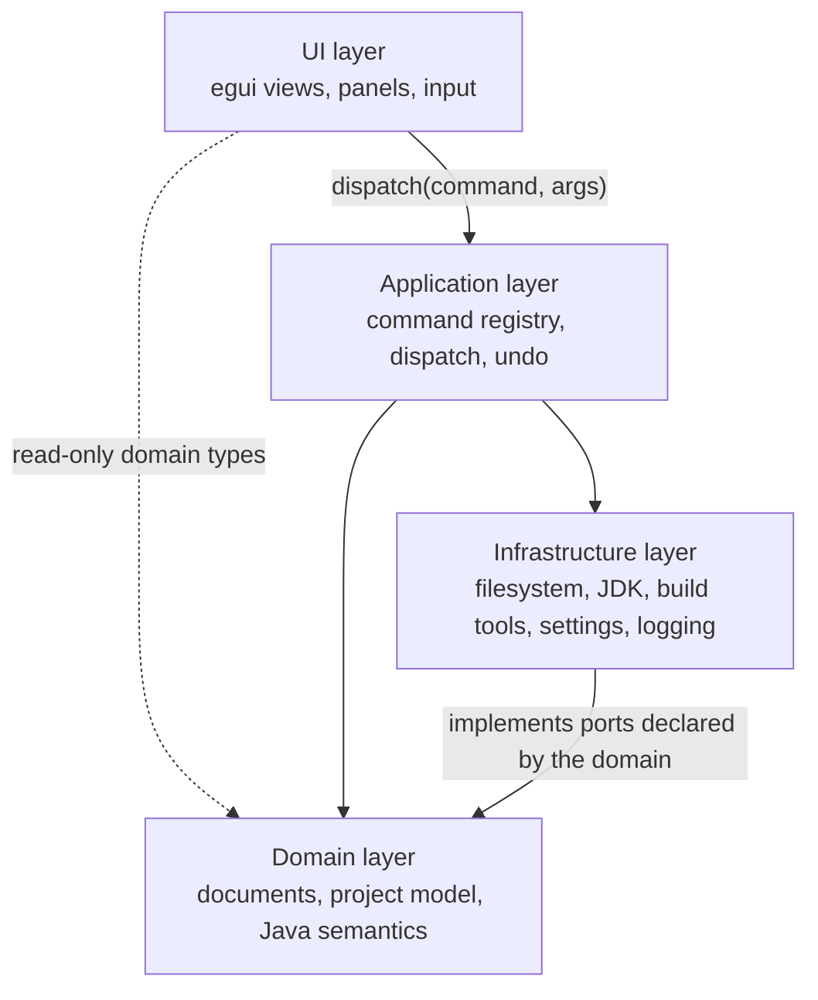

# Architecture

> **Document state:** design contract. The crate map, command executor, and current document model
> were recorded from the workspace on 2026-10-26; the requirements below remain binding. Anything
> not filled from the repository stays `Unknown`.

## Goals

The IDE is implemented in Rust with egui as its GUI framework. IntelliJ IDEA is the reference for
workflows and user-facing capabilities. The architecture must support incremental feature
development without coupling application logic to UI rendering.

Concretely, the architecture is designed so that:

1. **Behaviour is testable without a window.** Anything a user can trigger can be executed from a
   test or a script through the same command implementation.
2. **The UI can be replaced without rewriting the domain.** Panels read state and dispatch
   commands; they do not own editor rules.
3. **Edits are reversible.** Every document mutation that a user can perform is undoable, and undo
   is expressed in the command model rather than sprinkled through widgets.
4. **Slow work cannot freeze the frame.** Compilation, indexing, and process execution run outside
   the egui update and report progress through observable state.
5. **Nothing external is trusted.** Project files, build output, and automation input cross an
   explicit boundary (see [`security.md`](security.md)).

### Non-goals

- A general-purpose plugin platform with an in-process runtime in another language.
- Reusing IntelliJ platform code, protocols that require its binaries, or its asset formats.
- Multi-user, server-hosted editing. The IDE is a local desktop application.

## System shape

The diagram shows allowed directions, not concrete crates. Results and events travel back to the UI
as command return values and as state the frame reads; they are data, not dependency edges. The one
edge from a lower layer to a higher one — Infrastructure to Domain — is dependency inversion: the
domain declares and owns the ports (traits), infrastructure implements them, and the domain never
names a concrete implementation. Any other upward edge is a defect. Verify the real edges with
`cargo tree` before documenting them.

## Dependency layers

Dependencies flow toward stable, lower-level abstractions. Cycles are defects, not trade-offs.

| Layer | Responsibilities | May depend on | Must not contain |
|---|---|---|---|
| **UI** | egui views, panels, widgets, input mapping, presentation, focus | Application, Domain (read-only types) | File I/O, process spawning, undo logic, business rules |
| **Application** | Command registry and dispatch, undo/redo stack, job scheduling, event routing | Domain, Infrastructure | egui types, widget layout, direct rendering |
| **Domain** | Documents, project model, Java semantics, editing rules, validation | Nothing outward; it declares the ports that Infrastructure implements | egui types, filesystem or process access, global state, a dependency on Infrastructure |
| **Infrastructure** | Filesystem, JDK discovery, compiler/build invocation, settings persistence, logging, OS integration | Domain (port traits and value types) | UI types, command dispatch, domain rules |

Rules that follow from the table:

- A domain type must be constructible and assertable in a unit test with no window and no disk.
- Ports are declared by the layer that needs them — usually the domain — and implemented by
  infrastructure; tests substitute fakes at that seam. Avoid ambient singletons.
- The only edge from a lower layer to a higher one is Infrastructure implementing Domain ports.
  That is dependency inversion, not an upward dependency.
- If UI code needs a value, it reads it from state produced by the application layer. Do not call
  infrastructure from a widget.
- Logging and error reporting are infrastructure concerns, but the *decision* to log or notify is
  an application-layer decision.

### Crate map

Fill this from `cargo metadata --no-deps --format-version 1` and `cargo tree`. One row per package,
topological order, with the evidence that the row is accurate.

| Crate / package | Responsibility | Depends on | Status | Evidence |
|---|---|---|---|---|
| `kaffein-domain` | Documents, project tree data, and the ports infrastructure implements | standard library only | `Implemented` | `crates/kaffein-domain/src/lib.rs`; `cargo tree --depth 1 -p kaffein-domain` (2026-10-26) |
| `kaffein-app` | Command registry, single dispatch path, application state, undo orchestration | `kaffein-domain` | `Implemented` | `crates/kaffein-app/src/registry.rs`, `workspace.rs`; `cargo tree --depth 1 -p kaffein-app` |
| `kaffein-infra` | Filesystem adapter (UTF-8, size limit) and project scanner | `kaffein-domain` | `Implemented` | `crates/kaffein-infra/src/filesystem.rs`, `project_loader.rs` |
| `kaffein-ui` | egui views, layout, design tokens; emits commands instead of mutating state | `kaffein-app`, `kaffein-domain`, `egui 0.29.1` | `Implemented` | `crates/kaffein-ui/src/lib.rs`, `theme.rs`; `cargo tree --depth 1 -p kaffein-ui` |
| `kaffein` | Desktop binary; constructs infrastructure and wires it into the workspace | `kaffein-app`, `kaffein-infra`, `kaffein-ui`, `eframe`/`egui` | `Implemented` | `crates/kaffein/src/main.rs`; `cargo metadata --no-deps --format-version 1` |

Update this table when crates are added, removed, or change responsibility. If a crate's
responsibility cannot be stated in one sentence, that is an architecture signal, not a table
formatting problem.

## The engine/UI seam

The UI captures user input and presents state. It delegates actions to commands and does not own the
implementation of those actions.

Required properties:

- **Single implementation per action.** Menus, toolbar buttons, keyboard shortcuts, context menus,
  the command palette, tests, and automation call the same command.
- **Explicit context.** Commands receive what they need through a defined context or service set —
  the active document, project, selection, services, and cancellation token. No reaching into
  global UI state.
- **Structured results.** A command returns a result type that distinguishes success, no-op
  (precondition unmet), cancellation, and failure with a diagnostic. The UI decides how to present
  each.
- **Frame budget.** No command that touches the filesystem, a compiler, or a network call runs
  inside the egui update. Such commands start a job and report progress; the UI renders job state.
- **Re-entrancy safety.** A command triggered while another command runs must either queue, reject
  with a reason, or be explicitly re-entrant. This must be a documented decision, not an accident.
- **No egui types in domain APIs.** Colors, rectangles, and IDs from egui stop at the UI boundary.

The precise command executor, state ownership model, and asynchronous execution mechanism are
recorded below as they exist in the workspace, not assumed.

**Current executor (2026-10-26).** `CommandRegistry` owns one `Command` descriptor per action:
identifier, title, category, menu placement, toolbar placement, shortcuts, argument kind, enablement
predicate, optional checked predicate, and handler. `Workspace::dispatch` is the only dispatch path;
it resolves the command, validates required path arguments, runs the handler against `AppState` and
injected `Services`, and converts the `CommandOutcome` into a status message. Menus and the toolbar
are generated from the registry, and keyboard shortcuts are matched from the same descriptors. The
egui layer only collects `UiAction` values (command id plus arguments) and the binary dispatches
them after the frame. Internal commands (`editor.replace_text`, `editor.activate`) use the same path
without appearing in a menu.

No asynchronous job executor exists yet: commands run on the UI thread and the only current work is
in-memory editing plus bounded file/project reads. This meets the frame budget for the foundation
shell but is not sufficient for compilation or indexing.

## Command model

Treat each user-visible or otherwise executable IDE operation as a command. A command has:

| Part | Requirement |
|---|---|
| **Identifier** | Stable, namespaced (`editor.save`, `project.build`, `refactor.rename`), used by menus, settings, keymaps, and automation |
| **Arguments** | Explicit, serialisable where automation is intended; validated before any side effect |
| **Preconditions** | Checked up front and reported as a structured no-op, never as a silent success |
| **Effect** | Applied through domain APIs, not by mutating UI state |
| **Undo** | Either registers an inverse operation or is documented as non-undoable with a reason |
| **Result** | Success payload, diagnostics, and optionally a user-facing message |
| **Interruption** | Accepts cancellation for long work; partial effects are rolled back or declared |

The Command pattern does not mean every helper function must be a command. Internal calculations and
implementation details remain ordinary functions. A command exists when *something a user or an
automation client can trigger* exists.

### Registry and dispatch

- One registry lists commands with metadata: identifier, title, category, default shortcut,
  enabled-state predicate, and argument schema.
- Menus, the palette, keybindings, and automation clients are **views over the registry**. Adding a
  command must not require editing four separate lists.
- Enablement is derived from state (`can_execute`), not duplicated as booleans in widgets. A
  disabled control should be explainable ("requires a Java file in focus").

### Errors and diagnostics

- Errors carry a category (user input, unsupported state, tool failure, internal defect), a
  human-readable message, and an optional diagnostic with file/line/column.
- User-facing text is separate from internal context, so it can be localised later without touching
  domain code.
- Panics are defects. A panic in a command must not take down the whole application; whether that is
  achieved by isolation or by eliminating panics is an open decision.

### Asynchronous work

- Jobs have identity, progress, and a terminal state, and are observable by the UI without polling
  globals.
- Compilation, indexing, and tool invocations report diagnostics incrementally where the tool allows
  it.
- Cancellation is cooperative and observable: a cancelled job ends, cleans up, and reports
  cancellation rather than failing.

## Document model

Document the real source of truth for editor contents and their lifecycle here. Verify the
implementation before filling in the details; each row needs a decision and evidence, not a guess.

| Topic | Requirement | Decision | Status | Evidence |
|---|---|---|---|---|
| Identity and file association | Each open document has a stable identity distinct from its path, so unsaved and renamed documents are representable | `DocumentId(u64)` allocated by `AppState`; the path is separate and currently always present | `Implemented` | `crates/kaffein-domain/src/document.rs`; `AppState::allocate_document_id` |
| In-memory representation | Text storage is explicit (buffer, rope, or sequence) and documented together with its indexing unit (byte vs char vs UTF-16) | UTF-8 `String`, newlines normalised to `\n`. Undo diffing compares bytes; there is no incremental index yet | `Implemented` | `crates/kaffein-domain/src/document.rs`; `normalize_newlines`, `is_single_char_edit` |
| Open / create / save / reload / close | Each transition is a command, with defined ordering and failure behaviour | New, open, save, and close are commands. Reload is not implemented. Closing a dirty document is refused rather than discarding edits | `Partial` | `file.new`, `file.open`, `file.save`, `file.close`; `workspace::tests::creating_a_file_adds_a_dirty_document_without_writing`; gap: reload, discard flow |
| Dirty state and save prompts | Modified state derives from saved content, not from a boolean toggled by widgets | `buffer != saved_text`; `saved_text` is `None` until the first load or save, so a new document starts dirty. Saving replaces `saved_text` with the buffer | `Implemented` | `Document::is_dirty`, `mark_saved`, `Document::new`; `a_new_document_is_dirty_until_the_first_save` |
| Encoding and line endings | Detected, preserved, and overrideable per document; conversion is explicit, never silent | UTF-8 only; invalid UTF-8 fails to open. CRLF/LF detected at load and restored on save; mixed endings and BOM are not surfaced | `Partial` | `crates/kaffein-infra/src/filesystem.rs`; `LineEnding::detect`; gap: encoding selection, mixed-ending diagnostic |
| Undo / redo | Document-scoped history with grouping rules for typing and multi-step commands | Snapshot stack with 600 ms single-character coalescing; save keeps history; undo after edit clears redo | `Implemented` | `crates/kaffein-domain/src/document.rs`; `typing_within_the_window_coalesces_into_one_undo_step` |
| Multiple views of one document | Tabs and split views share one document and one undo stack | One editor view per document; tabs switch the active document. Split views are not implemented | `Partial` | `crates/kaffein-ui/src/lib.rs` › `draw_tabs`; gap: split views |
| External file changes | Detected change prompts a decision (reload, compare, ignore) without losing edits | Not detected | `Planned` | Roadmap M1 |
| Thread safety | Which thread owns the document, and how background jobs read or propose edits | The UI thread owns all state; no background job reads documents yet | `Implemented` | `crates/kaffein/src/main.rs`; `Workspace` is not shared across threads |

The UTF indexing unit deserves special attention: the JVM, Rust, and egui do not agree on string
width. Choose one canonical unit, document it, and convert only at boundaries.

## External Java tooling

The IDE stays implemented in Rust even when it invokes a JDK, compiler, build tool, test runner, or
language server. The boundary is infrastructure.

| Concern | Requirement |
|---|---|
| Discovery | Locate tools from explicit settings first, then environment (`JAVA_HOME`, `PATH`), then bundled locations; record which one was used |
| Versioning | Parse and validate versions before use; language level and tool version mismatches surface as diagnostics, not as parser crashes |
| Invocation | Pass arguments as a list, never through a shell string; set the working directory explicitly |
| Environment | Build the child environment deliberately; do not inherit everything by default |
| Output | Stream stdout/stderr, parse incrementally where possible, and keep raw output available for the user |
| Lifecycle | Own child processes: terminate on cancellation, reap on shutdown, and never leave orphans |
| Failure | Distinguish "tool missing", "tool crashed", and "tool reported an error" — they need different UI |
| Security | Project-provided build logic runs arbitrary code; the user consents before it runs (see [`security.md`](security.md)) |

Record supported tools, version discovery, and process lifecycle in this table once implemented.

## Open architectural questions

Track decisions that are still unresolved. When one is settled, record it here and update the
affected tables above.

| Question | Why it matters | Status |
|---|---|---|
| Text buffer representation and canonical index unit | Affects every editing command, diagnostics mapping, and performance | `Partial` — UTF-8 `String` normalised to `\n`; no rope or incremental index yet (see [Document model](#document-model)) |
| Undo granularity and command grouping | Determines how "one user action" is defined across typing, refactors, and tools | `Partial` — 600 ms single-character coalescing; grouping across commands is still open |
| Indexing strategy (in-process vs long-lived worker) | Dictates memory model and how stale results are rejected | `Unknown` |
| Build system integration depth (Gradle/Maven invocation vs native model) | Largest cost driver in the Java workflow stage | `Unknown` |
| Automation surface (headless CLI, control channel, MCP) and its security model | Determines testability and agent support | `Unknown` |
| Localisation strategy for UI text | Retrofitting is expensive; see [`ui-design.md`](ui-design.md) | `Unknown` |

## Verification

The crate map, command executor, and most Document model rows were recorded on 2026-10-26; steps
1–4 below were executed for the foundation shell. Remainder:

1. `cargo metadata --no-deps --format-version 1` → crate map (names, versions, targets).
2. `cargo tree --depth 1 -p <package>` for each package → dependency edges; flag any upward or
   cyclic edge as a defect.
3. Read the command registry → fill the registry metadata fields and confirm one dispatch path.
4. Write a state-transition test for document open → edit → undo → save → external change; record
   the observed model in the Document model table. The open/edit/undo/save half exists; reload and
   external change are still gaps.
5. Trace one external tool invocation end to end; record discovery order, environment, and
   cancellation behaviour.
6. Date every row you fill. Undated rows remain `Unknown`.
