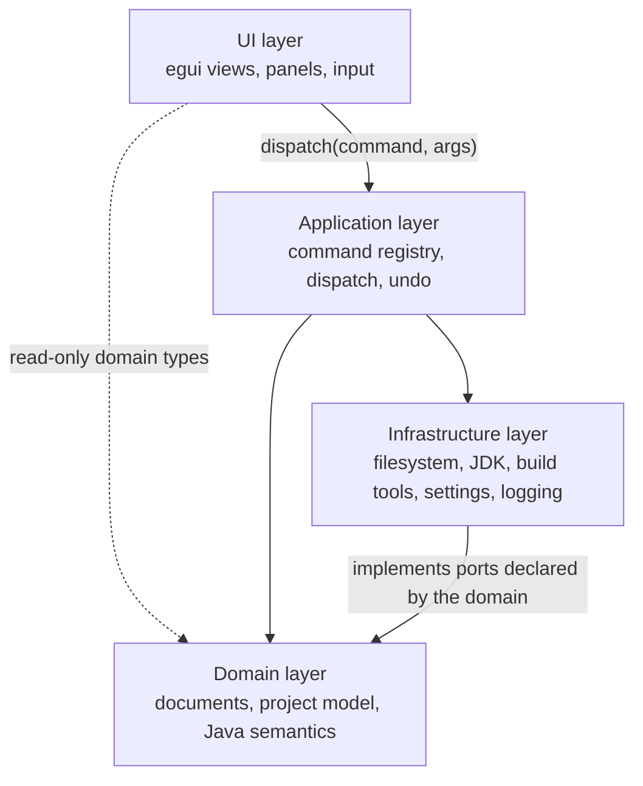

# Architecture

> **Document state:** design contract. The crate map, command executor, and current document model
> were recorded from the workspace on 2026-10-26; the requirements below remain binding. Anything
> not filled from the repository stays `Unknown`.

## Goals

The IDE is implemented in Rust with egui as its GUI framework. IntelliJ IDEA is the reference for
workflows and user-facing capabilities. The architecture must support incremental feature
development without coupling application logic to UI rendering.

Concretely, the architecture is designed so that:

1. **Behaviour is testable without a window.** Anything a user can trigger can be executed from a
   test or a script through the same command implementation.
2. **The UI can be replaced without rewriting the domain.** Panels read state and dispatch
   commands; they do not own editor rules.
3. **Edits are reversible.** Every document mutation that a user can perform is undoable, and undo
   is expressed in the command model rather than sprinkled through widgets.
4. **Slow work cannot freeze the frame.** Compilation, indexing, and process execution run outside
   the egui update and report progress through observable state.
5. **Nothing external is trusted.** Project files, build output, and automation input cross an
   explicit boundary (see [`security.md`](security.md)).

### Non-goals

- A general-purpose plugin platform with an in-process runtime in another language.
- Reusing IntelliJ platform code, protocols that require its binaries, or its asset formats.
- Multi-user, server-hosted editing. The IDE is a local desktop application.

## System shape

The diagram shows allowed directions, not concrete crates. Results and events travel back to the UI
as command return values and as state the frame reads; they are data, not dependency edges. The one
edge from a lower layer to a higher one — Infrastructure to Domain — is dependency inversion: the
domain declares and owns the ports (traits), infrastructure implements them, and the domain never
names a concrete implementation. Any other upward edge is a defect. Verify the real edges with
`cargo tree` before documenting them.

## Dependency layers

Dependencies flow toward stable, lower-level abstractions. Cycles are defects, not trade-offs.

| Layer | Responsibilities | May depend on | Must not contain |
|---|---|---|---|
| **UI** | egui views, panels, widgets, input mapping, presentation, focus | Application, Domain (read-only types), i18n | File I/O, process spawning, undo logic, business rules |
| **Application** | Command registry and dispatch, undo/redo stack, job scheduling, event routing | Domain, Infrastructure, i18n | egui types, widget layout, direct rendering |
| **Domain** | Documents, project model, Java semantics, editing rules, validation | Nothing outward; it declares the ports that Infrastructure implements | egui types, filesystem or process access, global state, a dependency on Infrastructure |
| **Infrastructure** | Filesystem, JDK discovery, compiler/build invocation, settings persistence, logging, OS integration | Domain (port traits and value types), i18n | UI types, command dispatch, domain rules |

`kaffein-i18n` is a shared text catalog, not a behavioural layer: it owns locale data and lookup, and
has no application, domain, or UI logic.

Rules that follow from the table:

- A domain type must be constructible and assertable in a unit test with no window and no disk.
- Ports are declared by the layer that needs them — usually the domain — and implemented by
  infrastructure; tests substitute fakes at that seam. Avoid ambient singletons.
- The only edge from a lower layer to a higher one is Infrastructure implementing Domain ports.
  That is dependency inversion, not an upward dependency.
- If UI code needs a value, it reads it from state produced by the application layer. Do not call
  infrastructure from a widget.
- Logging and error reporting are infrastructure concerns, but the *decision* to log or notify is
  an application-layer decision.

### Crate map

Fill this from `cargo metadata --no-deps --format-version 1` and `cargo tree`. One row per package,
topological order, with the evidence that the row is accurate.

| Crate / package | Responsibility | Depends on | Status | Evidence |
|---|---|---|---|---|
| `kaffein-domain` | Documents, project tree data, Java lexical/semantic analysis, and the ports infrastructure implements | standard library only | `Implemented` | `crates/kaffein-domain/src/lib.rs`, `java/`; `cargo tree --depth 1 -p kaffein-domain` (2026-10-28) |
| `kaffein-i18n` | Locale catalogs, deferred user-facing text, fallback, and culture-specific formatting | standard library, `serde_json 1.0.154` | `Implemented` | `crates/kaffein-i18n/src/`, `locales/`; `cargo tree --depth 1 -p kaffein-i18n` (2026-10-26) |
| `kaffein-app` | Command registry, single dispatch path, application state, undo orchestration, and Java-run job state | `kaffein-domain`, `kaffein-i18n` | `Implemented` | `crates/kaffein-app/src/registry/`, `workspace.rs`, `state/run.rs`; `cargo tree --depth 1 -p kaffein-app` (2026-10-28) |
| `kaffein-infra` | Filesystem adapter (UTF-8, size limit), project scanner, external locale storage, and the JDK compile/run adapter | `kaffein-domain`, `kaffein-i18n`, `serde_json 1.0.154` | `Implemented` | `crates/kaffein-infra/src/filesystem.rs`, `project_loader.rs`, `locale_files.rs`, `java_runner.rs`; `cargo tree --depth 1 -p kaffein-infra` (2026-10-28) |
| `kaffein-ui` | egui views, layout, design tokens, and Java syntax layout; emits commands instead of mutating state | `kaffein-app`, `kaffein-domain`, `kaffein-i18n`, `egui 0.29.1` | `Implemented` | `crates/kaffein-ui/src/lib.rs`, `editor.rs`, `syntax/`, `theme.rs`; `cargo tree --depth 1 -p kaffein-ui` (2026-10-28) |
| `kaffein` | Desktop binary; constructs infrastructure and wires it into the workspace | `kaffein-app`, `kaffein-i18n`, `kaffein-infra`, `kaffein-ui`, `eframe`/`egui` | `Implemented` | `crates/kaffein/src/main.rs`, `app.rs`; `cargo metadata --no-deps --format-version 1` (2026-10-28) |

Update this table when crates are added, removed, or change responsibility. If a crate's
responsibility cannot be stated in one sentence, that is an architecture signal, not a table
formatting problem.

### Module layout

A crate is the coarse boundary; a module is the fine one. A reader must be able to predict where a
piece of behaviour lives from its responsibility, and a reviewer must be able to read one file in
one sitting. The layout below is a rule, not a preference.

Rules:

- **One module, one responsibility.** The module doc comment states it in one sentence. If the
  sentence needs "and", it is two modules.
- **One folder per area.** A crate with more than one concern keeps `src/lib.rs` (or `src/main.rs`)
  for wiring and puts behaviour in `src/<area>.rs` or `src/<area>/`. `lib.rs` and `mod.rs` contain
  declarations, re-exports, and the entry point — not feature logic.
- **File budget.** A Rust source file stays at or below **300 lines**, tests included. A file that
  approaches the budget is split along its responsibilities, not truncated at an arbitrary line.
  Data tables such as `kaffein-ui/src/theme.rs` may approach the budget but still need a stated
  reason.
- **Tests live beside the code they prove.** Unit tests go in `src/<module>/tests.rs`, declared with
  `#[cfg(test)] mod tests;`. When they outgrow the budget, they are split by behaviour under
  `src/<module>/tests/`. Integration tests belong in `tests/` only when they need the crate's public
  API alone.
- **No dumping grounds.** A crate-level `utils.rs`, `helpers.rs`, or `misc.rs` is a defect: the
  helper belongs to the module that owns the rule. The only current exception is
  `kaffein-app/src/commands/helpers.rs`, which holds the argument and error shims shared by command
  implementations.
- **No hidden wiring.** Every module is declared exactly once, from its crate root or its owning
  module. Do not compile code through `#[path]` tricks.

Current layout, measured 2026-10-28 with the command in
[`development.md`](development.md) › File budget check:

| Crate | Modules | Largest file | Status |
|---|---|---|---|
| `kaffein-domain` | `document/` (model, `line_ending`, tests), `java/` (lexical analysis, semantic classification, source identity, token kinds, tests), `project.rs`, `ports.rs` (including the Java runner port) | `java/lexer/scan.rs` — 280 lines; `document.rs` — 252 lines | `Implemented` |
| `kaffein-i18n` | `lib.rs` (wiring), `keys.rs` (stable key table), `locale.rs` (language tags), `catalog.rs` (JSON and metadata parsing), `localizer.rs` (active/fallback lookup, switching, formatting), `source.rs` (external catalog seam), `text.rs` (deferred text), `format.rs` (numbers and dates), `tests.rs`; `locales/en.json`, `locales/pt-BR.json` | `localizer.rs` - 253 lines | `Implemented` |
| `kaffein-app` | `command/` (`command_id`, `args`, `outcome`, `keys`, `placement`), `commands/` (`file`, `edit`, `project`, `run`, `view`, `app`, `helpers`), `registry/` (`catalog`, `enablers`), `state/` (`state`, `run`), `services.rs`, `defaults.rs`, `paths.rs`, `workspace.rs` + `workspace/tests/` | `registry/catalog.rs` - 294 lines | `Implemented` |
| `kaffein-infra` | `filesystem.rs`, `project_loader.rs`, `locale_files.rs`, `java_runner.rs` (JDK compile/run), `test_support.rs` | `java_runner.rs` - 224 lines; `locale_files.rs` - 189 lines | `Implemented` |
| `kaffein-ui` | `lib.rs` (frame wiring), `actions.rs`, `editor.rs`, `menu.rs`, `toolbar.rs`, `status_bar.rs`, `project_panel.rs`, `bottom_panel.rs` + `bottom_panel/tests.rs` (run console), `path_prompt.rs`, `ui_state.rs`, `syntax/` (`theme`, `cache`, `layout`, `buffer`, tests), `theme.rs`, `tests.rs` | `syntax/cache.rs` - 296 lines | `Implemented` |
| `kaffein` | `main.rs` (entry point), `app.rs` (eframe adapter, startup scratch document, run polling) | `app.rs` - 100 lines | `Implemented` |

Update this table when a module moves, a file crosses the budget, or a crate gains an area. The line
counts are evidence for the budget, not a target to grow into. Module names resolve under
`crates/<crate>/src/`.

## The engine/UI seam

The UI captures user input and presents state. It delegates actions to commands and does not own the
implementation of those actions.

Required properties:

- **Single implementation per action.** Menus, toolbar buttons, keyboard shortcuts, context menus,
  the command palette, tests, and automation call the same command.
- **Explicit context.** Commands receive what they need through a defined context or service set —
  the active document, project, selection, services, and cancellation token. No reaching into
  global UI state.
- **Structured results.** A command returns a result type that distinguishes success, no-op
  (precondition unmet), cancellation, and failure with a diagnostic. The UI decides how to present
  each.
- **Frame budget.** No command that touches the filesystem, a compiler, or a network call runs
  inside the egui update. Such commands start a job and report progress; the UI renders job state.
- **Re-entrancy safety.** A command triggered while another command runs must either queue, reject
  with a reason, or be explicitly re-entrant. This must be a documented decision, not an accident.
- **No egui types in domain APIs.** Colors, rectangles, and IDs from egui stop at the UI boundary.

The precise command executor, state ownership model, and asynchronous execution mechanism are
recorded below as they exist in the workspace, not assumed.

**Current registry and dispatch (2026-10-26).** `CommandRegistry` owns one `Command` descriptor per action:
identifier, title key, category key, menu placement, toolbar placement, shortcuts, argument kind,
enablement predicate, optional checked predicate, and handler. `Workspace::dispatch` is the only
dispatch path; it resolves the command, validates required path arguments, runs the handler against
`AppState` and injected `Services` (including the `Localizer`), and stores the outcome. A
`CommandOutcome` carries deferred `Text`, which the status bar resolves every frame, so switching
locale also re-renders the message already on screen. Menus and the toolbar are generated from the
registry, and keyboard shortcuts are matched from the same descriptors. The egui layer only collects
`UiAction` values (command id plus arguments) and the binary dispatches them after the frame.
Internal commands (`editor.replace_text`, `editor.activate`) and locale switching
(`app.set_locale`) use the same path without appearing as ordinary menu entries.

**Current async execution (2026-10-28).** Commands still run on the UI thread, except `run.execute`, which
validates the active buffer, starts one worker thread through `AppState::start_run`, and returns
immediately. The worker calls the `JavaRunner` port and publishes a `RunState` snapshot; the UI polls
that snapshot once per frame and requests a repaint while it is `Running`. There is no general job
executor, queue, progress channel, or user cancellation command yet, so this is a single-purpose
mechanism rather than the async foundation described below.

## Command model

Treat each user-visible or otherwise executable IDE operation as a command. A command has:

| Part | Requirement |
|---|---|
| **Identifier** | Stable, namespaced (`editor.save`, `project.build`, `refactor.rename`), used by menus, settings, keymaps, and automation |
| **Arguments** | Explicit, serialisable where automation is intended; validated before any side effect |
| **Preconditions** | Checked up front and reported as a structured no-op, never as a silent success |
| **Effect** | Applied through domain APIs, not by mutating UI state |
| **Undo** | Either registers an inverse operation or is documented as non-undoable with a reason |
| **Result** | Success payload, diagnostics, and optionally a user-facing message |
| **Interruption** | Accepts cancellation for long work; partial effects are rolled back or declared |

The Command pattern does not mean every helper function must be a command. Internal calculations and
implementation details remain ordinary functions. A command exists when *something a user or an
automation client can trigger* exists.

### Registry and dispatch

- One registry lists commands with metadata: identifier, title, category, default shortcut,
  enabled-state predicate, and argument schema.
- Menus, the palette, keybindings, and automation clients are **views over the registry**. Adding a
  command must not require editing four separate lists.
- Enablement is derived from state (`can_execute`), not duplicated as booleans in widgets. A
  disabled control should be explainable ("requires a Java file in focus").

### Errors and diagnostics

- Errors carry a category (user input, unsupported state, tool failure, internal defect), a
  human-readable message, and an optional diagnostic with file/line/column.
- User-facing text is a deferred `Text` key with arguments, while internal context stays as values
  and diagnostics. The UI resolves the key without domain code knowing which locale is active.
- Panics are defects. A panic in a command must not take down the whole application; whether that is
  achieved by isolation or by eliminating panics is an open decision.

### Localisation

All user-facing copy is data, not source literals. The mechanism is `Implemented` on 2026-10-26:

| Concern | Decision | Evidence |
|---|---|---|
| Catalog | Nested JSON at `crates/kaffein-i18n/locales/en.json` and `pt-BR.json`, flattened to dot-separated keys at startup. Each file carries a `meta` block with its display name, decimal/group separators, and date pattern | `kaffein_i18n::catalog`; `every_declared_key_resolves_in_every_bundled_locale` |
| Key registry | Stable constants in `kaffein-i18n/src/keys.rs`; [`ALL`](../crates/kaffein-i18n/src/keys.rs) is the completeness test list. Plural families are prefixes (`<key>.one`, `<key>.other`) and are tested separately | same test; `plural_families_select_the_counted_form_and_format_the_number` |
| Runtime | `Localizer` is built once by the binary from `FileLocaleSource::discover()` and injected through `Services`; UI frames receive `&Localizer` | `crates/kaffein/src/main.rs`, `crates/kaffein-app/src/services.rs`, `crates/kaffein-ui/src/lib.rs` |
| Languages | A locale is `Locale { code, name }`, never an enum: embedded `en` and `pt-BR` ship, and `locales/<code>.json` adds a language without recompiling. `en` is the fallback when a catalog is missing | `kaffein_i18n::Locale`, `locales/` |
| External catalogs | `FileLocaleSource` reads `locales/*.json`, rejects invalid codes and files over 256 KiB, ignores malformed JSON, and merges valid entries over the embedded catalog for the same code | `crates/kaffein-infra/src/locale_files.rs`; `external_catalogs_override_embedded_ones_and_broken_files_are_ignored`, `ignores_catalogs_over_the_size_cap` |
| Persistence | The selected code is written to `settings.json` under `locale` while preserving other keys; `KAFFEIN_CONFIG_DIR` overrides the config root. A failed write leaves the previous locale active | `FileLocaleSource`; `switching_a_locale_persists_and_is_restored`, `a_persistence_failure_keeps_the_previous_locale` |
| Switching | `app.set_locale` changes the active locale. The View menu lists every loaded locale and the status bar shows the active one; the change takes effect on the next frame without a restart | `command.app.set_locale.title`; `switching_locale_rerenders_text_captured_before_the_switch` |
| Dynamic text | Catalog entries use `{name}` placeholders; `Localizer::render` substitutes values and selects `.one`/`.other` with `count == 1`. Numbers and dates use the active catalog's separators and date pattern. Plural selection is not full CLDR and date patterns support `YYYY`/`YY`/`MM`/`DD` only | `placeholders_are_replaced`, `numbers_and_dates_follow_the_catalog_metadata` |
| Deferred text | Command results and status messages store `Text` (key plus arguments) and resolve it at render time, so a locale change also re-renders messages stored before the switch | `kaffein_i18n::Text`; `text_resolves_at_render_time_and_follows_a_locale_change` |
| Missing keys | A key missing in the active locale falls back to `en`; missing in both is a defect that debug builds assert and release builds render as the key | `Localizer::lookup`, `Localizer::text` |

Rules:

- Command descriptors, menu titles, toolbar labels, tooltips, status messages, prompt copy, and
  infrastructure error templates name keys; they never embed English text.
- Domain types expose values and codes, not prose. The UI maps values such as `LineEnding` to keys.
- A translated sentence is one catalog entry with placeholders, never concatenated fragments.
- Adding a catalog entry means adding a key constant in the same change and updating every bundled
  catalog; `keys::ALL` is the test that prevents an untranslated entry from shipping unnoticed.
- A new language is a catalog file with valid `meta`, not a Rust match arm. Only code that genuinely
  branches on locale semantics may read the locale code.
- External catalogs are untrusted input: validate the language code, cap the file size, and ignore a
  file that does not parse instead of failing startup.

### Asynchronous work

- Jobs have identity, progress, and a terminal state, and are observable by the UI without polling
  globals.
- Compilation, indexing, and tool invocations report diagnostics incrementally where the tool allows
  it.
- Cancellation is cooperative and observable: a cancelled job ends, cleans up, and reports
  cancellation rather than failing.

**Current run job (2026-10-28).** `RunState` has an identity, a source name, and a terminal
`Finished`/`Failed` state. The worker publishes an `Arc<RunState>` snapshot through a shared
`Arc<Mutex<_>>` slot, so the UI can read the state without touching documents or copying captured
output on every frame. `run.execute` rejects a second run while one is active. There is no progress
channel and no cancellation command; the infrastructure kills a child that exceeds its timeout (10 s for
`javac`, 15 s for `java`) and reports `timed_out`. The UI polls the snapshot and repaints every
100 ms while the run is active. Status: `Partial`.

## Document model

Document the real source of truth for editor contents and their lifecycle here. Verify the
implementation before filling in the details; each row needs a decision and evidence, not a guess.

| Topic | Requirement | Decision | Status | Evidence |
|---|---|---|---|---|
| Identity and file association | Each open document has a stable identity distinct from its path, so unsaved and renamed documents are representable | `DocumentId(u64)` allocated by `AppState`; `path` is `Option<PathBuf>`, so a scratch document has identity without a file. `Document::scratch` is created at startup and by `file.new_scratch` | `Implemented` | `crates/kaffein-domain/src/document.rs`; `crates/kaffein-app/src/state.rs`; `a_scratch_document_has_no_path_and_starts_clean`; `a_scratch_document_is_editable_and_has_no_path` |
| In-memory representation | Text storage is explicit (buffer, rope, or sequence) and documented together with its indexing unit (byte vs char vs UTF-16) | UTF-8 `String`, newlines normalised to `\n`. Undo diffing compares bytes; there is no incremental index yet | `Implemented` | `crates/kaffein-domain/src/document.rs`; `normalize_newlines`, `is_single_char_edit` |
| Open / create / save / reload / close | Each transition is a command, with defined ordering and failure behaviour | New, open, save, close, and new-scratch are commands. Reload is not implemented. Closing a dirty path-backed document is refused rather than discarding edits; a dirty scratch document is discarded on close and excluded from the quit warning because it has no save destination. Saving a scratch document is refused with a message pointing to `file.new` | `Partial` | `file.new`, `file.new_scratch`, `file.open`, `file.save`, `file.close`; `closing_a_dirty_scratch_discards_it_without_a_prompt`; `saving_a_scratch_document_is_refused`; gap: reload, save-as for scratch, discard flow for path-backed files |
| Dirty state and save prompts | Modified state derives from saved content, not from a boolean toggled by widgets | `buffer != saved_text`; `saved_text` is `None` until the first load or save, so a new path-backed document starts dirty. A scratch document starts with its default text as saved content and becomes dirty on the first edit. `dirty_document_count` ignores scratch documents | `Implemented` | `Document::is_dirty`, `mark_saved`, `Document::new`, `Document::scratch`, `AppState::dirty_document_count`; `a_new_document_is_dirty_until_the_first_save`; `a_scratch_document_has_no_path_and_starts_clean` |
| Encoding and line endings | Detected, preserved, and overrideable per document; conversion is explicit, never silent | UTF-8 only; invalid UTF-8 fails to open. CRLF/LF detected at load and restored on save; mixed endings and BOM are not surfaced. A scratch document uses LF | `Partial` | `crates/kaffein-infra/src/filesystem.rs`; `LineEnding::detect`; gap: encoding selection, mixed-ending diagnostic |
| Undo / redo | Document-scoped history with grouping rules for typing and multi-step commands | Snapshot stack with 600 ms single-character coalescing; save keeps history; undo after edit clears redo | `Implemented` | `crates/kaffein-domain/src/document.rs`; `typing_within_the_window_coalesces_into_one_undo_step` |
| Multiple views of one document | Tabs and split views share one document and one undo stack | One editor view per document; tabs switch the active document. Split views are not implemented | `Partial` | `crates/kaffein-ui/src/editor.rs` › `draw_tabs`; gap: split views |
| External file changes | Detected change prompts a decision (reload, compare, ignore) without losing edits | Not detected | `Planned` | Roadmap M1 |
| Thread safety | Which thread owns the document, and how background jobs read or propose edits | The UI thread owns all state. The Java-run worker receives a copied source string and cannot read or mutate documents; it publishes only `RunState` | `Implemented` | `crates/kaffein/src/app.rs`; `crates/kaffein-app/src/commands/run.rs`; `crates/kaffein-app/src/state/run.rs` |

The UTF indexing unit deserves special attention: the JVM, Rust, and egui do not agree on string
width. Choose one canonical unit, document it, and convert only at boundaries.

## External Java tooling

The IDE stays implemented in Rust even when it invokes a JDK, compiler, build tool, test runner, or
language server. The boundary is infrastructure.

| Concern | Requirement |
|---|---|
| Discovery | Locate tools from explicit settings first, then environment (`JAVA_HOME`, `PATH`), then bundled locations; record which one was used |
| Versioning | Parse and validate versions before use; language level and tool version mismatches surface as diagnostics, not as parser crashes |
| Invocation | Pass arguments as a list, never through a shell string; set the working directory explicitly |
| Environment | Build the child environment deliberately; do not inherit everything by default |
| Output | Stream stdout/stderr, parse incrementally where possible, and keep raw output available for the user |
| Lifecycle | Own child processes: terminate on cancellation, reap on shutdown, and never leave orphans |
| Failure | Distinguish "tool missing", "tool crashed", and "tool reported an error" — they need different UI |
| Security | Project-provided build logic runs arbitrary code; the user consents before it runs (see [`security.md`](security.md)) |

**Current JDK runner (2026-10-28).** `StdJavaRunner` implements the `JavaRunner` port for
`run.execute`. It is a deliberately narrow adapter, not a build system integration.

| Concern | Current behaviour | Status | Evidence |
|---|---|---|---|
| Discovery | Invokes `javac` and `java` by name, so the OS resolves them from `PATH`. `JAVA_HOME` is not consulted and the selected tool path is not recorded | `Partial` | `crates/kaffein-infra/src/java_runner.rs` |
| Versioning | Does not parse or validate the JDK version; a JDK 8 installation cannot use source-file mode, so the adapter always writes a temporary file | `Partial` | `compiles_and_runs_a_source_string` (run with `--ignored` on JDK 1.8.0_401) |
| Invocation | Writes the buffer to a unique directory under the OS temp root, runs `javac -encoding UTF-8 -d . <Type>.java`, then `java -Dfile.encoding=UTF-8 -cp . <qualified.Type>`. Arguments are lists, never a shell string; the working directory is the temp directory | `Implemented` | `java_runner.rs`; `crates/kaffein-domain/src/java/name.rs` |
| Source identity | File name comes from the first public type (or first type if none is public); the launcher name adds the declared package | `Implemented` | `primary_type_name`, `package_name`; `java::name::tests` |
| Environment | The child inherits the parent environment, including credentials. This does not meet the deliberate-environment requirement | `Partial` | `java_runner.rs`; gap: environment allowlist |
| Output | stdout and stderr are captured on reader threads, capped at 256 KiB per stream, and marked when truncated. The UI strips CSI/OSC terminal escape sequences and other control characters before rendering | `Implemented` | `read_limited`; `sanitize_output`; `terminal_escape_sequences_are_removed`, `terminal_osc_sequences_are_removed` |
| Lifecycle | The child is polled, killed after 10 s (`javac`) or 15 s (`java`), and reaped. The temporary directory is removed after the run. There is no user cancellation command | `Partial` | `wait_for_exit`; `run_source` |
| Failure | Separates "tool missing" (`JavaRunErrorKind::Unavailable`), temporary-file I/O, and compiler/program failure with an exit code. The console distinguishes compile failure, run exit, timeout, and infrastructure failure | `Implemented` | `JavaRunError`, `JavaRunOutput`, `run_summary` |
| Security | Running the active buffer is an explicit user command; nothing runs on open. The program runs with the IDE's privileges in an isolated temp directory. Project build scripts and trust consent are not implemented | `Partial` | [`security.md`](security.md) › Process execution; `run.execute` |

## Open architectural questions

Track decisions that are still unresolved. When one is settled, record it here and update the
affected tables above.

| Question | Why it matters | Status |
|---|---|---|
| Text buffer representation and canonical index unit | Affects every editing command, diagnostics mapping, and performance | `Partial` — UTF-8 `String` normalised to `\n`; no rope or incremental index yet (see [Document model](#document-model)) |
| Undo granularity and command grouping | Determines how "one user action" is defined across typing, refactors, and tools | `Partial` — 600 ms single-character coalescing; grouping across commands is still open |
| Indexing strategy (in-process vs long-lived worker) | Dictates memory model and how stale results are rejected | `Unknown` |
| Build system integration depth (Gradle/Maven invocation vs native model) | Largest cost driver in the Java workflow stage | `Unknown` |
| Automation surface (headless CLI, control channel, MCP) and its security model | Determines testability and agent support | `Unknown` |
| Localisation strategy for UI text | Retrofitting is expensive; see [Localisation](#localisation) and [`ui-design.md`](ui-design.md) | `Implemented` — dynamic locale codes, embedded `en`/`pt-BR`, external catalogs, deferred text, and persistence; evidence in the [Localisation](#localisation) table (2026-10-26). Gap: no native-speaker review of the Portuguese catalog; no shipped surface displays a formatted date; plural selection is one/other only and formatting does not implement the full CLDR rule set (month names, alternate grouping sizes, time zones) |

## Verification

The crate map, module layout, command executor, and most Document model rows were recorded on
2026-10-26; steps 1–4 and 7 below were executed for the foundation shell. On 2026-10-28, step 5 was
traced for `run.execute` (`StdJavaRunner`, JDK 1.8.0_401) and the module-layout table was remeasured.
Remainder:

1. `cargo metadata --no-deps --format-version 1` → crate map (names, versions, targets).
2. `cargo tree --depth 1 -p <package>` for each package → dependency edges; flag any upward or
   cyclic edge as a defect.
3. Read the command registry → fill the registry metadata fields and confirm one dispatch path.
4. Write a state-transition test for document open → edit → undo → save → external change; record
   the observed model in the Document model table. The open/edit/undo/save half exists; reload and
   external change are still gaps.
5. Trace one external tool invocation end to end; record discovery order, environment, and
   cancellation behaviour. Executed for `run.execute` on 2026-10-28; see the Current JDK runner
   table and [`security.md`](security.md) › Process execution.
6. Date every row you fill. Undated rows remain `Unknown`.
7. Re-run the file budget check in [`development.md`](development.md) › File budget check; update
   the module-layout table if a file exceeds 300 lines or a module moved.
8. Re-run `cargo test -p kaffein-i18n every_declared_key_resolves_in_every_bundled_locale` after
   adding or renaming a candidate key; the catalog completeness test proves every key in
   [`ALL`](../crates/kaffein-i18n/src/keys.rs) resolves in every bundled catalog (`en`, `pt-BR`).
   Add a plural-family key to both catalogs before referencing it in a command or widget.
