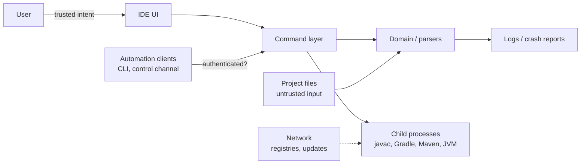

# Security

> **Document state:** threat model and control requirements. Controls marked `Partial` have a
> foundation implementation in the workspace, but none has been independently audited or tested as a
> security control, so no row is `Verified`.

An IDE is an unusually privileged application. It opens files it did not author, parses them with
hand-written code, spawns compilers and build tools, and holds the user's source code, environment,
and often their credentials in memory. A photo editor that mishandles a file corrupts an image; an
IDE that mishandles a project can execute an attacker's code.

This document covers what can go wrong and what the project requires as mitigation. It is written
before the code exists so the controls are designed in rather than bolted on.

## Assets

| Asset | Why it matters | Where it lives |
|---|---|---|
| User source code | Intellectual property; often under NDA | project directories, editor buffers |
| Credentials and tokens | Repositories, package registries, CI | environment variables, settings files, credential stores |
| The user's machine | Build scripts and plugins run with user privileges | child processes |
| Build artifacts | Supply-chain integrity | project build output |
| IDE settings and history | Reveals project names, paths, recent activity | configuration directory |
| Automation surface | Can drive the UI and read documents | loopback listener / CLI |
| Logs and crash reports | Frequently contain paths, code excerpts, tokens | log directory |

## Trust boundaries

| Boundary | Trusted side | Untrusted side | Rule |
|---|---|---|---|
| B1 | IDE | Project content, file names, archive entries | Parse defensively; never execute content to inspect it |
| B2 | IDE | Child process output | Treat stdout/stderr as data; sanitise before rendering |
| B3 | IDE | Automation clients | Authenticate, bind to loopback, off by default |
| B4 | IDE | Network resources | Require explicit user action; verify integrity |
| B5 | IDE | Update artifacts | Signature verification before install |
| B6 | IDE | Environment | Do not inherit the whole environment into children; never log it wholesale |

## Threats

| ID | Threat | Example | Impact | Control (required) | Status |
|---|---|---|---|---|---|
| T-01 | Arbitrary code execution via project build logic | A cloned repository's build script runs on open | Full user compromise | Never build on open; explicit "trust this project" consent; show the command that will run | `Proposed` |
| T-02 | Malicious build plugins or annotation processors | A dependency executes at configuration time | Full user compromise | Consent covers dependency resolution; pin/verify where possible; make the network step visible | `Proposed` |
| T-03 | Path traversal / archive slip | A jar or source archive entry named `../../.ssh/authorized_keys` | File overwrite | Canonicalise and confine every extracted path to the destination root | `Proposed` |
| T-04 | Symlink and junction escape | A project symlink pointing outside the workspace | Write outside the project | Resolve links before writing; never follow links out of the workspace silently. Foundation: the project scanner skips symlinks (`crates/kaffein-infra/src/project_loader.rs`); explicitly opened file paths are still followed | `Partial` |
| T-05 | Resource exhaustion | Deeply nested generics, a 2 GB single-line file, zip bombs | Freeze or OOM | Input size/depth limits, streaming parse, cancellable indexing, per-file budget. Foundation: 8 MiB file cap (`filesystem.rs`), 256 KiB locale catalog cap (`locale_files.rs`), scan depth 8 and 500 entries per directory (`project_loader.rs`) | `Partial` |
| T-06 | Parser memory-safety defect | Malformed source triggering a panic or worse | Crash, potential corruption | Safe Rust, fuzz targets for every parser, no `unsafe` parsing, panic-free error paths | `Proposed` |
| T-07 | Terminal escape injection | Build output containing OSC sequences that rewrite the window title or paste clipboard content | UI spoofing, clipboard hijack | Strip or neutralise control sequences before rendering | `Proposed` |
| T-08 | Secret leakage in logs | A stack trace containing a token from the environment | Credential theft | Redact known secret patterns; deny-list environment dumps; log at boundaries only | `Proposed` |
| T-09 | Automation endpoint abuse | A malicious web page calls the loopback control channel | Read source, drive UI, exfiltrate | Loopback bind, per-launch random token, origin checks, off unless explicitly enabled | `Proposed` |
| T-10 | Cross-site request to localhost (DNS rebinding) | Page resolves to `127.0.0.1` and calls the endpoint | Same as T-09 | Validate `Host` and `Origin`, require the token header, no wildcard CORS | `Proposed` |
| T-11 | Malicious plugin / extension | A plugin reads every buffer and posts it out | Full compromise | Out-of-process isolation, declared capabilities, user consent per capability | `Proposed` |
| T-12 | Update channel compromise | A tampered release artifact | Full compromise | Signed artifacts, verified before install, no silent downgrade | `Proposed` |
| T-13 | Malicious workspace settings | Project config disables a safety check or sets a shell command | Code execution via settings | Machine-scoped vs project-scoped settings; project settings that execute code require consent | `Proposed` |
| T-14 | Clipboard and drag-and-drop spoofing | Dropping a file that claims to be a source file | Confusion, wrong-file edit | Validate type and size; show the resolved path before acting | `Proposed` |
| T-15 | Test fixture leakage | Fixtures containing real credentials or personal paths | Privacy breach | Synthetic fixtures only; scan before commit | `Proposed` |

When a control moves to `Implemented`, link the implementing module and test. When it moves to
`Verified`, add the audit note: who checked it, when, and how.

## Automation security

The automation surface is the largest new attack surface an IDE can add, and the most tempting to
ship on by default because it makes testing easy.

Requirements:

1. **Off by default.** The control channel requires an explicit flag or setting per launch. It does
   not persist silently across restarts.
2. **Loopback only.** Bind `127.0.0.1` (and `::1`), never `0.0.0.0`. Do not follow a user-supplied
   interface without an explicit warning.
3. **Authenticated.** A random token generated per launch, printed to the launching terminal, and
   required on every request. No default token, no token in a file readable by other users.
4. **Origin-checked.** Reject requests with a browser-style `Origin` unless explicitly allowed, and
   validate `Host` to defeat DNS rebinding.
5. **Capability-scoped.** Read-only inspection, input injection, and file writes are separate
   permissions; a client asks for what it needs.
6. **Auditable.** Every automation-driven mutation is logged with the client identity, and the UI
   shows that automation is active.
7. **No privilege escalation.** Automation cannot change security settings, trust a project, or
   install a plugin.

The headless CLI is lower risk because the user runs it deliberately: it inherits the terminal's
privileges and needs no listener. Keep batch/headless paths process-local and keep the listener for
interactive UI control only.

## Secrets and data handling

- Never write source content, environment values, or tokens into logs, crash reports, or screenshots
  by default.
- Redact known patterns (tokens, private keys, `*_TOKEN`, `*_SECRET`, connection strings) before any
  diagnostic is written.
- Child processes receive a constructed environment. Do not forward credentials unless the command
  needs them, and say so in the UI when it does.
- Settings that contain credentials belong in the OS credential store, not in a plain settings file.
- Crash reports and telemetry are opt-in, and the payload is inspectable before sending.
- Documentation and fixtures must never contain real hosted-repository tokens, internal hostnames, or
  user paths.

## Parsing untrusted input

Applies to source files, build files, archives, class files, and anything imported from disk.

- Every parser has a fuzz target and a regression corpus; a crash is a bug with a test attached.
- Limits are explicit: file size, token length, nesting depth, entry count, decompressed size.
- Prefer streaming and bounded buffers over "read it all, then parse".
- Errors are values, not panics. A malformed file must produce a diagnostic and leave the IDE usable.
- No `unsafe` in parsing code without a written justification and a focused audit.
- Absolute and relative paths are validated against an explicit root, and the resolved path is what
  the user sees.
- Locale catalogs are external input: validate the language code used as the file stem, cap the file
  size, and ignore a file that does not parse instead of failing startup.

## Process execution

- Arguments are passed as a list; no shell string interpolation, ever.
- Working directory and environment are set explicitly.
- Child processes are tracked, cancellable, and reaped; no orphan processes after quit.
- Output is bounded in memory and streamed to a durable log when large.
- Exit status, signal, and timeout are distinguished in the UI, because "the build failed" and "the
  build tool is missing" need different fixes.

## Reporting a vulnerability

A private reporting channel must exist before the first public release. Until one is recorded here,
do not publish security-sensitive details in public issues.

| Field | Value |
|---|---|
| Private channel | `TBD` — must be recorded before release |
| Acknowledged within | `TBD` |
| Disclosure policy | `TBD` |
| Supported versions | `TBD` |

## Verification

1. Walk the threat table with the first implementation and mark each control `Implemented` or
   `Proposed`, linking the module and test.
2. Add fuzz targets for every parser and record them in [`development.md`](development.md).
3. Audit the automation surface against the seven requirements above; record the result.
4. Add a secrets scan to CI and confirm it fails on a deliberately planted token.
5. Record the private reporting channel before any public release.
6. Date the audit; an undated security claim is not a claim.
